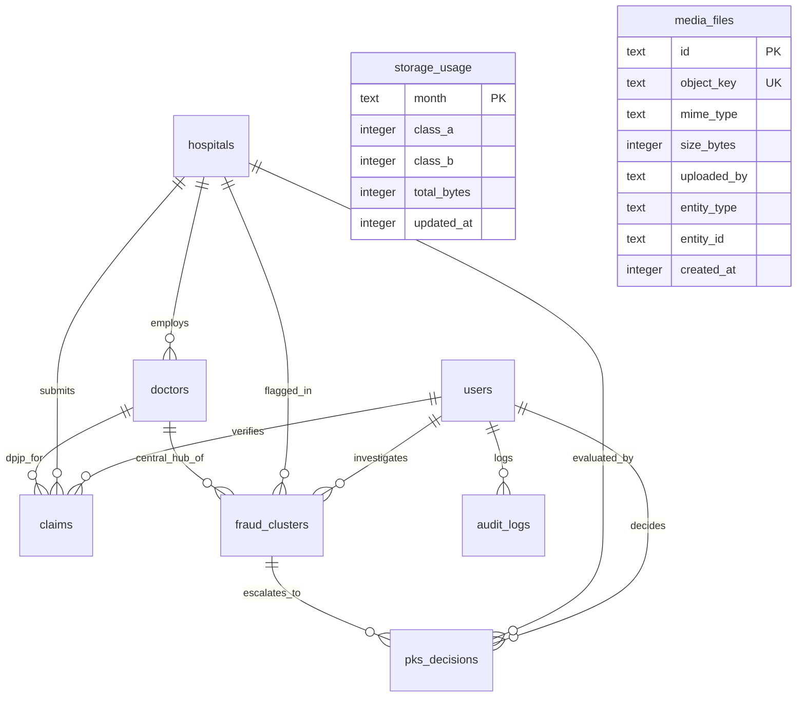

# Plan 01 — Persiapan Database Cloudflare D1, Skema Drizzle ORM & Migrasi

**Proyek:** ClaimGuard AI (`claimguard-ai-app`)  
**Target Infrastruktur:** Cloudflare D1 (`claimguard-db`) + Drizzle ORM (`drizzle-orm/d1`) + D1 Quota Guard 95%  
**Referensi Utama:** `../BLUEPRINT.md`, `../../../docs/03_ALIRAN_DATA_DAN_INTEGRASI.md`, `../../../docs/04_USER_JOURNEY_DAN_SOP_AUDITOR.md`, `../../../docs/05_LOGIKA_SISTEM_DAN_ALGORITMA.md`, `../../../anti-slop/audit-003-full-system-ui-ux-2026-11-23.md`

---

## 1. Tujuan Fase Persiapan Database

1. Membuat database **Cloudflare D1** bernama `claimguard-db` di akun Cloudflare aktif dan mengikatnya ke `wrangler.jsonc` (`binding: "DB"`).
2. Mengganti driver starter `better-sqlite3` (tidak kompatibel dengan runtime `workerd` Cloudflare Workers) menjadi factory `getDb(env)` berbasis `drizzle-orm/d1` yang dibungkus **D1 Quota Guard (95% Circuit Breaker)**.
3. Merancang skema relasional SQLite portabel (`src/db/schema.ts`) yang mencakup:
   - Infrastruktur Zero-Cost Protection (`storage_usage`, `media_files`).
   - Operasional 3 Peran Closed-Loop Governance (`users`, `hospitals`, `doctors`, `claims`, `fraud_clusters`, `pks_decisions`, `audit_logs`).
4. Menghasilkan file migrasi SQL resmi lewat `drizzle-kit generate` (`drizzle/0000_*.sql`) serta menerapkannya ke **D1 Lokal** (`--local`) dan **D1 Remote** Cloudflare.

---

## 2. Desain Relasi Tabel (ERD Ringkas)

---

## 3. Rincian 9 Tabel & Strategi Index (Efisiensi Kuota D1 `rows_read`)

Cloudflare D1 Free Tier memiliki batas **5.000.000 `rows_read` / hari** (Circuit Breaker aktif di **4.750.000**). Setiap tabel diberi index pada kolom `WHERE` / `ORDER BY` utama agar tidak terjadi *full table scan*:

| No | Tabel | Fungsi Utama & Layar Terkait | Index Wajib |
|---|---|---|---|
| 1 | `storage_usage` | Counter bulanan (`YYYY-MM`) Class A, Class B, `total_bytes` untuk R2 95% Circuit Breaker (`BLUEPRINT.md`) | PK `month` |
| 2 | `media_files` | Katalog file Private R2 pengganti `R2.list()` (bukti klarifikasi, dokumen sidak, BA PKS) | `idx_media_uploaded_by`, `idx_media_entity` |
| 3 | `users` | 3 persona RBAC (`verifikator`, `auditor_wilayah`, `kepala_cabang`) | `idx_users_role` |
| 4 | `hospitals` | 12 FKRTL mitra KC Malang + faskes lintas cabang Divre Jatim (BOR, 4 pilar PMK 16/2019, TGR, PKS) — `UI 1.1`, `2.1–2.3`, `3.1–3.4` | `idx_hospitals_branch`, `idx_hospitals_pks_status`, `idx_hospitals_compliance_score` |
| 5 | `doctors` | DPJP, rasio tindakan ulang, jumlah faskes praktik, counter penolakan berturut-turut (Trigger #3 ≥ 5) — `UI 1.2–1.3`, `2.2` | `idx_doctors_hospital` |
| 6 | `claims` | Berkas SEP (pseudonim UU PDP), skor 3-lapis (`score_medical`, `score_statistical`, `score_network`, `risk_score`), zona, status manusia, cache narasi On-Demand LLM — `UI 1.1–1.4` | `idx_claims_status_score`, `idx_claims_hospital_status`, `idx_claims_doctor_status`, `idx_claims_zone`, `idx_claims_typology`, `idx_claims_sla` |
| 7 | `fraud_clusters` | Kluster eskalasi wilayah Divre Jatim (payload graf 5-simpul, hasil sidak CCTV/register, TGR, rekomendasi PKS) — `UI 2.1–2.3` | `idx_clusters_branch_priority`, `idx_clusters_hospital`, `idx_clusters_stage` |
| 8 | `pks_decisions` | Evaluasi & penguncian kontrak PKS tahunan Kepala Cabang (syarat addendum, BA rapat, nomor *e-Office*) — `UI 3.3–3.4` | `idx_pks_hospital`, `idx_pks_locked` |
| 9 | `audit_logs` | Rekam jejak audit permanen (*immutable*) setiap keputusan manusia & transisi status — `UI 1.4` & akuntabilitas hukum | `idx_audit_entity`, `idx_audit_created`, `idx_audit_actor` |

---

## 4. Catatan Teknis Penting

1. **Kepatuhan UU PDP No. 27/2022:** Tabel `claims` sengaja **tidak memiliki kolom** `patient_name`, `patient_nik_raw`, `phone`, atau `address`. Hanya menyimpan `patient_alias` (`Pasien #B-9021`), `patient_nik_masked` (`357301******0003`), `patient_card_hash` (salted SHA-256), serta `patient_gender` & `patient_age`.
2. **D1 Quota Guard (`src/db/d1-guard.ts`):**
   - Membungkus `D1Database` lewat `Proxy` untuk mengakumulasi `meta.rows_read` dan `meta.rows_written`.
   - Jika binding `USAGE_KV` tersedia, melakukan sinkronisasi setiap 10 detik dan *flush* segera saat lonjakan (`reads > 2500` atau `writes > 250`) atau menyentuh batas 95%.
   - Jika `USAGE_KV` belum terpasang di tahap pengembangan lokal awal, guard tetap melindungi lewat counter memori *isolate* per hari UTC tanpa mematahkan alur lokal.
3. **Sinkronisasi Konsistensi Data (Audit 003):**
   - `RSUD Medika Malang` (`0195R008` / `#JTM-01`) = Tipe B · 180 TT · kasus **Kateterisasi Jantung PCI (`37.22`) / `dr. Hendra Wijaya, Sp.JP`** · BOR Total 98%, Kardiologi/VIP 118% · TGR **Rp 420.000.000**.
   - `RS Hermosa Malang` (`0195R011` / `#JTM-02`) = Tipe C · 110 TT · kasus **Phantom Billing Rawat Inap & Unbundling Obat** · TGR **Rp 200.000.000**.
   - Total komitmen TGR KC Malang = **Rp 620.000.000**.
4. **Migrasi Masa Depan (Portabilitas):** Seluruh definisi memakai tipe SQL standar `drizzle-orm/sqlite-core` (`text`, `integer`, `real`) sehingga migrasi ke PostgreSQL/MySQL di masa depan hanya perlu mengganti helper tabel & driver di `src/db/index.ts`.

---

## 5. Checklist Eksekusi Fase Persiapan Database

- [x] Buat database D1 `claimguard-db` di Cloudflare (`database_id: 21a8143d-7bbb-48b7-afb4-2e2bc5937c4f`, wilayah `APAC`).
- [x] Update `wrangler.jsonc` (`name: "claimguard-ai-app"`, binding `DB`, `migrations_dir: "drizzle"`).
- [x] Tulis `src/db/schema.ts`, `src/db/d1-guard.ts`, dan refactor `src/db/index.ts` ke `drizzle-orm/d1`.
- [x] Generate migrasi SQL via `bun run db:generate` → `drizzle/0000_burly_talos.sql` (9 tabel + 26 index + FK).
- [x] Terapkan migrasi ke D1 Lokal (`bun run db:migrate:local`) dan D1 Remote Cloudflare (`d1_migrations` tercatat sinkron).
- [x] Verifikasi daftar tabel, index, dan jalankan unit self-check `src/db/d1-guard.check.ts` + `tsc --noEmit` (0 error di seluruh modul `src/db/`).
- [x] Catat metadata D1 (`database_id`, skema, keputusan teknis) ke **UTEKE Memory** lokal (`namespace: claimguard-ai`).

> **Catatan Temuan Starter:** File bawaan starter `src/routes/demo/table.tsx` memiliki error tipe pre-existing karena template memakai `@tanstack/react-table` v9 dengan API v8. File demo ini akan dihapus/diganti saat implementasi tabel ClaimGuard AI pada fase frontend.
